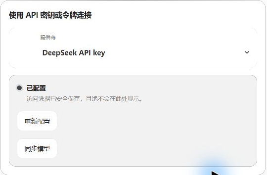
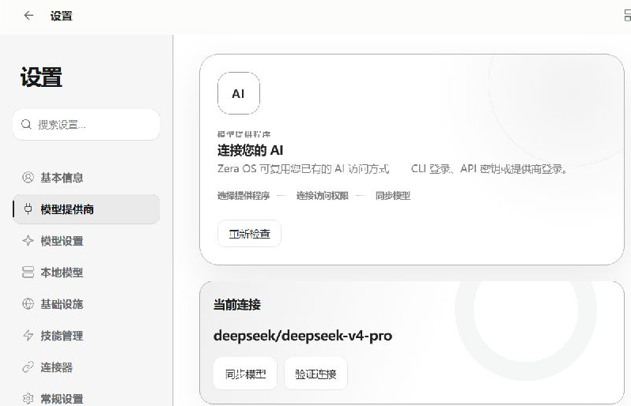
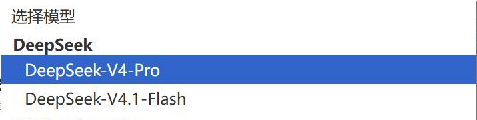
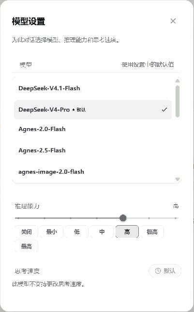

[English](./lumii.md) | [简体中文](./lumii.zh-CN.md) · [← 返回](../README.zh-CN.md)

# 在 LUMII 中接入 DeepSeek

[LUMII（ZERA AI OS）](https://zeraneo.com/) 是 Windows AI Agent 桌面助手，提供聊天、工作空间和工具。它内置原生 DeepSeek 提供商，可使用你自己的 DeepSeek API Key，通过 `https://api.deepseek.com` 的 OpenAI 兼容 Chat Completions 接口调用模型。

> 草稿验证状态（2026-10-08）：已在本地 LUMII 1.2.6 安装版检查设置入口、模型选项和“最高”推理档位，并核对源码中的提供商映射。现有 DeepSeek 账号返回 HTTP 402，成功对话与多轮工具调用尚待验证。公开下载版与本次检查的安装版具有不同的包标识，也仍需独立走通教程。下文示例是验证步骤，不是已成功运行的记录。

## 1. 安装并准备账号

1. 从 [LUMII 官方下载页](https://zeraneo.com/download) 获取 Windows 安装包。本教程面向 Windows 10/11 x64。
2. 运行安装包，等待所需组件安装完成，打开 LUMII，按提示完成软件账号登录。
3. 如果首次登录出现模型设置向导，可选择“**暂时跳过**”，然后按下文通过设置连接 DeepSeek。
4. 在 [DeepSeek 开放平台](https://platform.deepseek.com/api_keys) 获取 API Key，并确认对应账号有可用 API 余额。LUMII 账号与 DeepSeek API 账号分别管理；登录 LUMII 不会提供 DeepSeek API 额度。收费标准以 [DeepSeek 官方价格页](https://api-docs.deepseek.com/quick_start/pricing/) 为准。

## 2. 连接原生 DeepSeek 提供商

1. 点击左下角账号菜单，进入“**设置 → 模型提供商**”。
2. 向下找到“**使用 API 密钥或令牌连接**”，在“提供商”中选择“**DeepSeek API key**”。
3. 在“**API 密钥或令牌**”中填写 Key，点击“**保存配置**”。如果已有凭据，卡片会显示“**已配置**”而不显示密钥；需要替换时才使用“**重新配置**”。
4. 在 DeepSeek 卡片中点击“**同步模型**”。凭据已保存或列表可见，均不代表付费模型请求一定成功。
5. 查看“**当前连接**”。原生 Pro 连接的模型引用是 `deepseek/deepseek-v4-pro`。





原生提供商负责接口地址和模型元数据，这条接入路径无需另写自定义提供商 JSON，也无需手填上下文上限。

## 3. 选择模型和最高推理档位

[DeepSeek 当前官方目录](https://api-docs.deepseek.com/quick_start/pricing/) 使用以下模型 ID，两者均支持 **1M（100 万 token）上下文**。LUMII 原生目录包含相应上下文元数据；实际可输入的内容还要为系统指令和工具定义等留出空间。

| API 模型 ID | LUMII 显示名称 | 输入 |
| --- | --- | --- |
| `deepseek-flash` | DeepSeek-V4.1-Flash / DeepSeek V4.1 Flash | 文本、图片 |
| `deepseek-v4-pro` | DeepSeek-V4-Pro / DeepSeek V4 Pro | 文本 |

Flash 使用 `deepseek-flash`，官方目前将旧版 V4 Flash 名称作为别名处理。选择“**DeepSeek**”提供商，因为其他提供商也可能提供相似名称的模型。



1. 点击“**新任务**”，选择要使用的 Agent。
2. 点击输入框底部的模型名称或“**推理**”控件，打开“**模型设置**”，选择 **DeepSeek V4 Pro** 或 **DeepSeek V4.1 Flash**。
3. 在“**推理能力**”中选择“**最高**”（英文界面为 **Maximum**）。它对应 LUMII 的 `max` 档位；源码适配器将其映射为 `reasoning_effort: "max"`，并开启思考，符合 [DeepSeek 思考模式接口](https://api-docs.deepseek.com/guides/thinking_mode/)。
4. 关闭弹窗，发送前核对输入框底部的模型与推理标签。选择立即作用于当前对话；“**继承：高**”表示当前继承的是高档位，并非最高。




LUMII 原生 DeepSeek 适配器还将“低／最小”映射为 `low`，“中／高”映射为 `high`，“极高／最高”映射为 `max`。“**思考速度**”是独立控件，本次检查的 DeepSeek 模型不提供速度覆盖选项。

## 4. 首次对话

以下请求会消耗 DeepSeek API 余额。余额可用后，保持选中的 DeepSeek 模型及最高推理档位，发送：

> 17 × 23 等于多少？只回复结果。

预期结果为 `391`。然后在同一对话中发送：

> 在上一条结果上加 9，只回复新结果。

预期结果为 `400`。确认模型仍为 DeepSeek、两次回复均正常结束，且没有余额、鉴权或提供商错误。预期答案不代表这些请求已经通过实测。

## 5. 验证开启思考的多轮工具调用

通过输入框下方的文件夹控件选择一个小型测试工作空间，用文本编辑器在其中创建 `deepseek-demo.txt`，内容如下：

```text
item: demo
quantity: 12
unit_price: 3
```

保持最高推理档位，发送：

> 用文件读取工具读取当前工作空间中的 deepseek-demo.txt，计算 quantity × unit_price。只读取文件，不修改文件，也不向外部发送任何内容。

在同一对话中继续发送：

> 再次用文件读取工具读取 deepseek-demo.txt，确认 item 名称及上一轮的总额。只读取文件。

检查两轮是否都有实际的文件读取工具记录，最终答案是否包含总额 `36` 和名称 `demo`。如果工具不可用，先解决工作空间或工具访问问题；仅有文字回答而没有工具记录，不能证明多轮工具调用通过。

DeepSeek 要求后续携带工具的请求回传此前助手消息的 `reasoning_content`。LUMII 原生提供商声明了这一兼容要求，但上述两轮的成功执行仍待实测。详见 [官方思考模式工具调用要求](https://api-docs.deepseek.com/guides/thinking_mode/#tool-calls)。

## 6. 常见问题

先展开错误详情，结合 [DeepSeek 官方错误码说明](https://api-docs.deepseek.com/quick_start/error_codes/) 判断原因。

| 现象 | 处理方向 |
| --- | --- |
| `401` | 检查 DeepSeek Key，以及当前 Agent／提供商实际使用的凭据。 |
| `402` / `Insufficient Balance` | 检查 DeepSeek API 账号余额，余额可用后再重试。 |
| `429` | 降低并发，等待后重试。 |
| `503` | 等待提供商恢复后重试。 |
| `400` 且详情提到 `reasoning_content` | 检查 LUMII 版本，通过软件帮助／支持入口反馈错误详情；验证修复时保持思考开启。 |
| 模型选择器中没有 DeepSeek | 确认目标 Agent 已配置 DeepSeek API key，同步该提供商并重新打开模型选择器；同步失败需保留错误详情。 |
| 某个对话仍显示其他模型 | 在该对话的“模型设置”中选择 DeepSeek；修改 Agent 默认模型不能证明已有对话已使用新模型。 |

反馈时保留软件版本、选中的提供商／模型、触发操作及错误码，不附 API Key 或私有工作空间内容。
